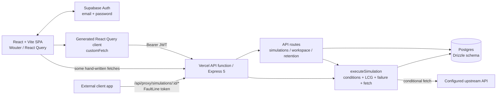
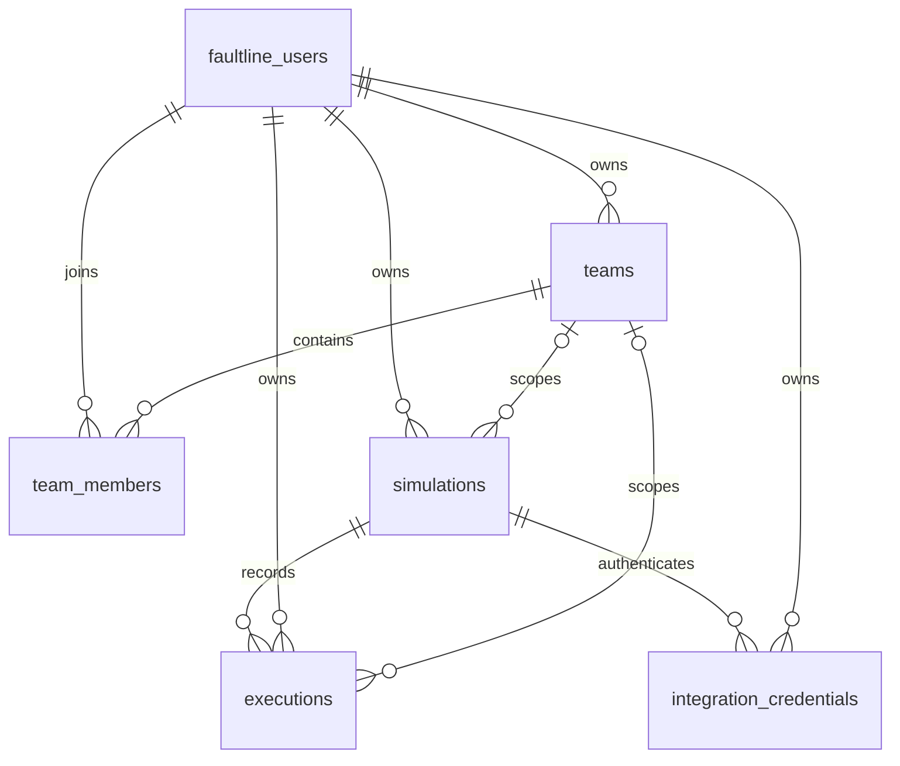

# FaultLine Technical Reference

**Repository audit date:** 2026-11-15  
**Scope:** Current checked-out `main` source and Git history. This document is based on implementation files, schemas, migrations, package manifests, deployment configuration, and available verification runs—not on README claims alone.

## How to read this reference

- **Verified** means directly present in the tracked source/configuration inspected.
- **Partial / caveat** means a UI or API exists but the behavior has material limits or discrepancies.
- **Not verified** means this repository does not contain enough evidence to establish the claim or a production result.
- Resume bullets below are phrased as project capabilities, not claims about individual authorship. Adapt them to work you personally performed and can defend.

## 1. Project overview

FaultLine is a web control plane and HTTP simulator. A user configures a scenario around a target URL, method, request template, conditions, failure mode, probability, latency, and forwarding policy. The control plane can run it directly, while an external application can send traffic through a per-simulation proxy endpoint using an integration token. Each run produces a persisted execution record for inspection, replay, comparison, or recovery-workflow use.

The practical problem is exercising client behavior for failure paths—such as HTTP errors, timeouts, latency, malformed or empty bodies, and connection loss—without requiring the target service to be modified. The intended users are developers and teams validating retry, error-handling, and recovery behavior against development or staging systems.

What distinguishes the implementation from a conventional API test runner is the long-lived simulation configuration and live proxy path: traffic is evaluated against scenario rules, may be forwarded to a configured upstream, and is recorded as an execution. The repository also has a dashboard, a run inspector, snippets/templates, and workspace/team scaffolding.

**Actual limitations:** the failure engine is concentrated in one Express route module; the pseudo-random default seed repeats for the same simulation; recovery and replay contain behavior gaps; API tests cover selected engine, utility, and clean-first-run route behavior, while the frontend has no automated test setup; and several UI/API contract surfaces are out of sync. It should be described as a development/testing simulator, not as a production-grade service mesh, fault-injection platform, or complete resilience-testing suite.

## 2. Architecture



### Monorepo responsibilities

| Area                          | Responsibility                                                                                                                       |
| ----------------------------- | ------------------------------------------------------------------------------------------------------------------------------------ |
| `apps/frontend`               | React/Vite browser SPA; dashboard, simulations, integration settings, inspector, replay, comparison, recovery and workspace screens. |
| `apps/api`                    | Express application, authentication middleware, route handlers, simulation engine, logging and retention cleanup.                    |
| `packages/db`                 | Drizzle Postgres connection, schema definitions and SQL migration history.                                                           |
| `packages/api-spec`           | OpenAPI source and Orval code-generation configuration.                                                                              |
| `packages/api-zod`            | Generated Zod request/response validators and types derived from OpenAPI.                                                            |
| `packages/api-client-react`   | Orval-generated TanStack Query hooks plus `customFetch`.                                                                             |
| `api/index.ts`                | Vercel serverless entry point importing the built Express app.                                                                       |
| `experimental/mockup-sandbox` | Separate UI mockup workspace; it is not imported by the FaultLine frontend.                                                          |
| `tooling/scripts`             | Small workspace script package; current tracked source is a hello-world entry point, not a FaultLine service.                        |

### Runtime and request lifecycle

1. Vercel serves the compiled Vite SPA for non-API paths and rewrites `/api/*` to `/api/index` (`vercel.json`). The API entry imports `apps/api/dist/app.mjs`; API builds bundle `app.ts` and `server.ts` with esbuild (`apps/api/build.mjs`).
2. The browser initializes Supabase from Vite-exposed URL/publishable-key values (`apps/frontend/src/lib/supabase.ts`). `AuthGate` signs users in with email/password and registers an access-token getter with the shared client.
3. Generated client hooks issue `/api/...` requests through `customFetch`, which attaches `Authorization: Bearer <Supabase access token>` when configured. Most application routes require that bearer token.
4. The Express app logs requests with Pino, parses JSON and URL-encoded bodies, starts retention cleanup, and mounts all routes beneath `/api` (`apps/api/src/app.ts`).
5. A dashboard run resolves a simulation with user/team access checks. An external proxy request resolves the simulation ID, handles CORS, authenticates either a dashboard JWT or a per-simulation token, translates incoming HTTP request data into engine overrides, and calls the same `executeSimulation` function.
6. The engine evaluates conditions/probability, selects a failure outcome, optionally calls the upstream with `fetch`, and inserts an `executions` row. It then updates the simulation counters and returns the execution. The proxy writes that execution’s simulated/forwarded headers, status and body back to the external client; timeout and connection-failure outcomes destroy the response socket.

The browser SPA uses Wouter for routing and TanStack React Query for generated API data fetching/caching. A routed/global error boundary, loading placeholders, and query-error states exist. `apps/frontend/src/App.tsx` contains a large share of the route/page composition; the specialized action panels are in separate component files.

## 3. Simulation and failure behavior

### Configuration and CRUD

`apps/frontend/src/App.tsx` (`SimulationForm`, `SimulationEditor`) defines name, target URL, method, headers, query parameters, request body, failure mode, response, delay/timeout, probability, condition rules, forwarding, response-header preservation, allowed browser origins, and enabled state. It parses the JSON text fields client-side and checks target URL protocol, name, numeric ranges, and origin syntax. `CreateSimulationBody` / `UpdateSimulationBody` in the generated Zod package perform server-side validation for fields included in the contract; the API responds 400 on failed parsing.

Creation is `POST /api/simulations`; editing is `PATCH /api/simulations/:id`; deletion is `DELETE /api/simulations/:id`. Failure Recipes (`apps/frontend/src/components/simulation-recipes.tsx`) are client-side presets that prefill the regular form. They do not create a different backend type. Duplicate loads the source simulation into the same form with a `copy` name and reset local counters; saving creates a new row. Team assignment is not part of the visible form payload, even though the create handler accepts a raw `teamId` property.

### Request matching

`matchesConditions()` in `apps/api/src/routes/simulations.ts` treats an empty condition object as a match. Optional rules are combined as **AND** checks:

- Method: configured method uppercased equals the request method.
- Path: configured path and target URL pathname are normalized by removing one trailing slash, then compared exactly.
- Headers: each configured key/value must equal a request-header value. The code tries a lower-case key and then the original key; it does not normalize all incoming keys into one canonical case-insensitive map.
- Query: exact string equality for each configured key/value.
- Body: `bodyContains` is a literal substring of the serialized request-body string.

No glob, regex, JSONPath, numeric comparison, or partial query matching is implemented. External request path matching uses the effective target pathname after suffix append. These checks are rule predicates, not a general-purpose request-matching language.

### Probability and seeded randomness

`seededRandom(seed)` is a 32-bit linear congruential generator (LCG) in `simulations.ts`:

```text
state₀ = seed >>> 0
stateₙ₊₁ = (1664525 × stateₙ + 1013904223) mod 2³²
uₙ = stateₙ₊₁ / 2³²
```

`executeSimulation()` clamps configured probability to [0, 100] and injects when a non-`none` configured failure is selected and either probability is at least 100, or `u × 100 < probability`. The normal seed is the simulation database ID; the function creates a fresh LCG for every execution. Therefore identical simulation ID and probability produce the same first random value on each run—repeated requests are deterministic, not independent random trials. A run override can supply a seed, but the generated `RunSimulationBody` schema has no seed field. Recovery supplies incremented seeds per attempt; replay UI exposes a seed but its generated replay schema strips that unknown property before engine invocation.

### Supported failure modes

The source union and OpenAPI/Zod schemas include: `none`, `http_400`, `http_401`, `http_403`, `http_404`, `http_429`, `http_500`, `http_502`, `http_503`, `timeout`, `latency`, `connection_failure`, `malformed_json`, `empty_response`, and `duplicate_response`.

- HTTP modes select fixed status codes from `failureStatuses`; a simulation’s status field is not used to override the mapped code for these named modes.
- `timeout` waits `simulation.timeoutMs`, records timeout/null status/body and ultimately closes the external socket.
- `latency` waits the configured `latencyMs`; it can still forward to the upstream when forwarding is on.
- `connection_failure` emits no HTTP response and destroys the external connection.
- `malformed_json` uses an intentionally invalid JSON string; `empty_response` uses an empty string.
- `duplicate_response` is represented as one HTTP 502 with diagnostic JSON and `x-faultline-duplicate-response`; the comment explicitly explains that HTTP cannot return two responses for one request.
- HTTP errors use a configured response body when present, otherwise `defaultFailureBody()` for mapped HTTP error types.

### Engine path, forwarding and result persistence

`executeSimulation(simulation, overrides, requestOverrides)` is the shared implementation for dashboard run, proxy run, replay and recovery. It constructs an effective target URL, merges the path suffix for proxy requests, picks request method/headers/query/body, evaluates conditions, chooses the failure type, and applies the configured delay/failure behavior.

Forwarding occurs only when the selected result is `none` or `latency`, and `simulation.forwardRequest` is true or source is external. The engine builds the URL with `URL.searchParams.set`, calls Node `fetch` with an AbortController and `forwardTimeoutMs`, omits bodies for GET/HEAD, captures upstream response text/status, and marks status success only when `upstream.ok`. When configured to preserve headers it copies upstream response headers; otherwise it keeps only content type. `Set-Cookie` is separately collected with `Headers.getSetCookie()` where available and stored as a string array. Non-forwarded `none` returns status 200 and no body.

Each execution stores URL, request method/headers/query/body, failure type, response headers/body, returned status, observed latency, status class, source, token-authenticated flag, request IP, timestamps, and a generated timeline. The timeline is synthetic (fixed offsets of +8/+18/+28 ms from a common base time), not a trace of actual internal operations. Simulation counters are updated after insertion using read-plus-write values derived from the simulation object supplied to the function, rather than atomic SQL increments.

**Important edge cases in current logic:**

- If an injected failure is not selected, the engine still derives `configuredLatency` from the simulation and delays in the non-timeout branch. Thus a `latency` scenario’s configured delay can occur even when probability says not to inject.
- An upstream non-2xx response sets the execution `status` to `failure` but leaves `failureType` as `none`; counter updates decide failure from the injected failure type or timeout, so this upstream failure can increment `successCount` instead of `failedCount`.
- A `none` or un-injected outcome without forwarding produces a synthetic 200/null body. It is not a real upstream call.
- Timeline timestamps are explanatory placeholders; use `actualLatencyMs` for elapsed time, not the timeline gaps.
- Parallel requests can lose counter increments because counters are updated from a previously read simulation snapshot.

### Proxy CORS, headers, cookies and authentication

The proxy is `router.all(/^\/proxy\/simulations\/(\d+)(\/.*)?$/, handleProxy)` under the `/api` mount. Its effective public path is `/api/proxy/simulations/:id` with an optional suffix.

For browser requests, `applyProxyCors()` allows a fixed development origin (`http://localhost:5173`) and configured `allowedOrigins`, then sets credential, method, header, `Vary`, and exposed-header CORS responses. OPTIONS preflight is handled before integration-token validation and validates requested method and header names. The accepted request headers are `Content-Type` and `X-FaultLine-Token`; token parsing also accepts `X-Execution-Token`, but that alias is not in the preflight allowlist. The helper `originAllowed()` is unused. A configured `*` is filtered out of the exact-origin allowlist, despite the form hint suggesting wildcard support, so wildcard is not actually honored. No `Origin` header bypasses browser CORS checks (normal for server-to-server requests).

A proxy request with a verified dashboard Bearer token is accepted without a FaultLine token. Otherwise it must supply an integration token. Token credentials are per simulation: `ft_live_` plus 32 random bytes encoded as base64url; only the prefix and bcrypt hash (cost 12) are persisted; the raw token is returned once, expires after 90 days, and can be revoked or regenerated. Last-used time and IP are recorded. The source also retains legacy `simulations.executionToken` but active token generation uses `integration_credentials`.

Incoming request headers are copied except `host`, `x-faultline-token`, and `x-execution-token`; therefore Authorization and Cookie are forwarded to the target and are also persisted in the execution record. JSON and URL-encoded bodies are parsed by Express; other content types are not explicitly supported by a raw-body parser. Upstream Set-Cookie values are handled as a multi-value array and written back. Logging redacts authorization/cookie/set-cookie, but execution persistence is separate and does not mask request headers.

## 4. Frontend features and status

| Feature                       | Implementation and status                                                                                                                                                                                                                                                                                                                                                                                                                                                                                                                                                                 |
| ----------------------------- | ----------------------------------------------------------------------------------------------------------------------------------------------------------------------------------------------------------------------------------------------------------------------------------------------------------------------------------------------------------------------------------------------------------------------------------------------------------------------------------------------------------------------------------------------------------------------------------------- |
| Dashboard                     | Verified. `/` polls dashboard summary every 10 seconds; shows counters, recent runs, fleet and recent scenarios. Initial eight executions are loaded by the dashboard endpoint. Infinite scrolling requests older pages of 25 via `beforeId`; `seenRecentRuns` retains records observed across polls.                                                                                                                                                                                                                                                                                     |
| Simulation list               | Verified. Lists, client-side searches by name/URL/failure type, run, navigate to detail, and confirm deletion.                                                                                                                                                                                                                                                                                                                                                                                                                                                                            |
| Scenario recipes              | Verified. Eleven presets exist in `simulation-recipes.tsx`; only the first two are separately shown as quick-pick cards and all are available from a select. These only prefill values.                                                                                                                                                                                                                                                                                                                                                                                                   |
| Simulation detail             | Verified. Shows stats, endpoint, integration panel, and recent executions. Detail API includes 20 runs, while the frontend separately uses list executions (API cap 100).                                                                                                                                                                                                                                                                                                                                                                                                                 |
| Integration panel             | Verified with limitations. Issues/revokes/regenerates token, displays masked prefix, configures origins and builds a generic `fetch` integration snippet. The component suppresses initial integration read errors by showing a no-token fallback.                                                                                                                                                                                                                                                                                                                                        |
| Execution inspector           | Verified. Request/response data, status, latency, synthetic timeline, developer actions and a regression-test generator. Stored request headers are shown in the inspector; only generated request snippets mask sensitive headers by default.                                                                                                                                                                                                                                                                                                                                            |
| Developer actions             | Verified as template generation. In `developer-actions.tsx`, request formats include cURL, fetch, Axios, Python requests and raw HTTP. Sensitive header masking covers names matching authorization/cookie/set-cookie/x-api-key. Error-handling code is only available for TypeScript + fetch; the generated sample itself is illustrative and calls placeholder functions such as `retryWithBackoff` / `handleClientError`. “Why did this fail?” recomputes condition indicators in the UI; it is not a server-side stored decision trace. Its displayed seed says it was not persisted. |
| Regression tests              | Verified as copyable text generation only (`regression-test-generator.tsx`), for Vitest, Jest, Playwright, pytest and JUnit. It does not write files, execute tests, install frameworks or guarantee the chosen template compiles. The templates have omissions (for example, some ignore observed headers/body/response assertions); treat them as starting points.                                                                                                                                                                                                                      |
| Replay                        | Partially implemented. `POST /api/executions/:id/replay` creates a new execution using current simulation configuration plus the source execution’s method/headers/query/body and optional overrides. The original row is immutable. It does not restore the original target path suffix, is not a frozen-simulation snapshot, and the replay UI seed field is not accepted by the schema.                                                                                                                                                                                                |
| Comparison                    | Verified. Compares two accessible execution rows and returns booleans for status/failure type/response/timeline plus signed latency delta. It does not compute structural JSON diffs or compare request headers/body/URL. The UI’s list of candidates comes from the capped simulation execution endpoint.                                                                                                                                                                                                                                                                                |
| Recovery                      | Partially implemented. UI builds ordered steps with attempt count and latency; backend clamps attempts to 1–100, runs steps serially and returns executions plus whether the last one has status `success`. See recovery caveat below.                                                                                                                                                                                                                                                                                                                                                    |
| Settings, teams and retention | Partial. Profile, create/join team, team selection for retention, personal/team retention and logout UI exist. Team membership and policy APIs exist, but simulation creation UI does not associate new simulations with selected teams; there is no team-edit/delete/member-management API. Settings uses raw `fetch` without the shared Bearer-token getter, although the server requires Bearer auth for `/workspace` routes, so these calls are likely to receive 401 in the normal application flow.                                                                                 |

### Recovery workflow behavior (important qualification)

The route loops over each supplied workflow step and each attempt, awaiting `executeSimulation()` serially. It increments the supplied seed per attempt. However, `executeSimulation()` first resolves `workflow = overrides.workflow ?? simulation.workflow`; it then chooses the first stored step with `attempts > 0` and gives that step’s failure type precedence over the individual `overrides.failureType`. The recovery caller does not pass `workflow` in its overrides. Therefore, when the saved simulation itself has a non-empty workflow, that first stored step can override every recovery step; even when it does not, execution results are not used to short-circuit once recovered. The feature executes and records groups of runs, but should not be described as a full adaptive retry/fallback engine without fixing and testing this behavior.

## 5. Backend API reference

All paths below are under `/api`. Except for `/proxy/simulations/...`, `requireAuth` requires `Authorization: Bearer <Supabase JWT>`. The proxy accepts either that session or a simulation integration token as described above. API error/status behavior is based on route source; some responses are not represented in OpenAPI.

### Health and dashboard

| Method / path                          | Auth                                      | Input and validation                                      | Response / behavior                                                                                                 |
| -------------------------------------- | ----------------------------------------- | --------------------------------------------------------- | ------------------------------------------------------------------------------------------------------------------- |
| `GET /healthz`                         | Bearer required in current app middleware | None                                                      | `{ status: "ok" }`; Zod-validated. This is not an unauthenticated health probe.                                     |
| `GET /dashboard`                       | Bearer                                    | None; ensures the authenticated user profile exists, without creating simulations | Counts total/active simulations, sums counters, includes up to 8 recent executions.                                 |
| `GET /dashboard/executions?beforeId=N` | Bearer                                    | `beforeId` must be a positive safe integer; otherwise 400 | Up to 25 older accessible executions, descending ID. This route is implemented in Express but missing from OpenAPI. |

### Simulations and execution history

| Method / path                      | Auth   | Input and validation                                                                                                                                                                                                                                                                                                                                                          | Response / behavior                                                                                                                                                                                                       |
| ---------------------------------- | ------ | ----------------------------------------------------------------------------------------------------------------------------------------------------------------------------------------------------------------------------------------------------------------------------------------------------------------------------------------------------------------------------- | ------------------------------------------------------------------------------------------------------------------------------------------------------------------------------------------------------------------------- |
| `GET /simulations`                 | Bearer | None; ensures the authenticated user profile exists without creating simulations                                                                                                                                                                                                                                                                                                                               | Accessible simulations, ordered by updated time, with generated `endpoint`.                                                                                                                                               |
| `POST /simulations`                | Bearer | JSON `CreateSimulationBody`: required name (nonempty), HTTP(S)-valid URL, method from GET/POST/PUT/PATCH/DELETE; optional headers/query string maps, request/response bodies, failure mode, code 100–599, latency/timeout 0–120000, probability 0–100, conditions/workflow, forwarding, origins and enabled. Team membership checked only when raw body `teamId` is a number. | 201 simulation. Missing optionals receive explicit defaults. Invalid schema 400; unauthorized team 403.                                                                                                                   |
| `GET /simulations/:id`             | Bearer | Positive integer ID (Zod coerces)                                                                                                                                                                                                                                                                                                                                             | Simulation plus up to 20 latest executions. Inaccessible or absent returns 404.                                                                                                                                           |
| `PATCH /simulations/:id`           | Bearer | Positive integer ID and partial `UpdateSimulationBody` (same supported editable fields/ranges)                                                                                                                                                                                                                                                                                | Updated simulation; invalid body/ID 400; missing/inaccessible 404. Does not support changing owner/team.                                                                                                                  |
| `DELETE /simulations/:id`          | Bearer | Positive integer ID                                                                                                                                                                                                                                                                                                                                                           | Deletes simulation; executions and integration credentials cascade through FK; 204.                                                                                                                                       |
| `GET /simulations/:id/executions`  | Bearer | Positive integer ID                                                                                                                                                                                                                                                                                                                                                           | Up to 100 latest executions. No cursor/limit parameter in route.                                                                                                                                                          |
| `POST /simulations/:id/executions` | Bearer | Optional body `failureType`, `statusCode` 100–599, `latencyMs` 0–120000, `responseBody`; no seed in validator                                                                                                                                                                                                                                                                 | Runs engine and returns created execution (201).                                                                                                                                                                          |
| `GET /executions/:id`              | Bearer | Positive integer ID                                                                                                                                                                                                                                                                                                                                                           | Execution inspector payload or 404. Access is checked through joined simulation access.                                                                                                                                   |
| `POST /executions/:id/replay`      | Bearer | Same override body as run; unknown `seed` is stripped by Zod                                                                                                                                                                                                                                                                                                                  | Re-runs source request shape through the current simulation and creates another execution (201).                                                                                                                          |
| `POST /executions/:id/compare`     | Bearer | `{ replayExecutionId: positive integer }`                                                                                                                                                                                                                                                                                                                                     | `{ original, replay, differences }`; 404 if either is unavailable to user. `differences` has `status`, `latencyMs`, `failureType`, `response`, `timeline`. The handler does not require same simulation for the two rows. |
| `POST /simulations/:id/recovery`   | Bearer | Optional `{ seed, workflow: [{ failureType, statusCode?, attempts?, latencyMs? }] }`; handler clamps attempts 1–100 but route uses request body directly rather than `CreateRecoveryWorkflowBody.safeParse`                                                                                                                                                                   | Executes all configured attempts sequentially; returns `{ executions, recovered }`. `recovered` only checks whether the last execution is `success`.                                                                      |

### Integration credentials and browser origins

| Method / path                                        | Auth   | Input                                                                                              | Response / behavior                                                                                                         |
| ---------------------------------------------------- | ------ | -------------------------------------------------------------------------------------------------- | --------------------------------------------------------------------------------------------------------------------------- |
| `GET /simulations/:id/integration`                   | Bearer | Simulation ID (converted with `Number`; unlike main CRUD route this handler does not Zod-parse it) | `{ credential: summary-or-null, allowedOrigins }`; summary omits token/hash.                                                |
| `PUT /simulations/:id/integration/origins`           | Bearer | `{ origins: string[] }`; non-array becomes empty; entries stringified, trimmed, deduplicated       | `{ allowedOrigins }`. This route does not validate origin URL syntax server-side.                                           |
| `POST /simulations/:id/integration/token`            | Bearer | No body                                                                                            | 201 `{ token, credential }`; raw token shown once. Existing active credentials for that simulation/owner are revoked first. |
| `POST /simulations/:id/integration/token/regenerate` | Bearer | No body                                                                                            | Same token response and revocation process as issue.                                                                        |
| `POST /simulations/:id/integration/token/revoke`     | Bearer | No body                                                                                            | Revokes active credentials and returns 204.                                                                                 |

### Workspace, team and retention

| Method / path                | Auth   | Input and checks                                            | Response / behavior                                                                                                                                                                                |
| ---------------------------- | ------ | ----------------------------------------------------------- | -------------------------------------------------------------------------------------------------------------------------------------------------------------------------------------------------- |
| `GET /workspace`             | Bearer | None                                                        | Profile plus teams where user is a member, team code and retention dates. Ensures a local profile row exists.                                                                                      |
| `POST /teams`                | Bearer | `{ name, code }`; name at least 2 chars and code at least 6 | Creates team and owner membership (201). Stores SHA-256 code hash and plaintext `teamCode`.                                                                                                        |
| `POST /teams/join`           | Bearer | `{ code }`; at least 6 chars                                | Looks up hash, adds membership idempotently; 404 if no team.                                                                                                                                       |
| `PATCH /workspace/retention` | Bearer | `{ weeks: 1 \| 2, teamId?: integer }`                       | Updates personal retention or team policy if caller is a member and, for team policy, team owner. 400 invalid policy; 403 unauthorized membership/owner. Returns weeks and computed deletion date. |

### External simulator proxy

| Method / path                              | Auth                                                                                                                                 | Input and behavior                                                                                                                                                                                                                          | Response                                                                                                                                                                                                                                                     |
| ------------------------------------------ | ------------------------------------------------------------------------------------------------------------------------------------ | ------------------------------------------------------------------------------------------------------------------------------------------------------------------------------------------------------------------------------------------- | ------------------------------------------------------------------------------------------------------------------------------------------------------------------------------------------------------------------------------------------------------------ |
| Any HTTP method `/proxy/simulations/:id/*` | Valid dashboard JWT **or** integration token in `X-FaultLine-Token` / `X-Execution-Token`; `OPTIONS` handles CORS before token check | ID must be positive integer. Incoming method limited to GET/POST/PUT/PATCH/DELETE, otherwise engine receives POST. Query strings become a string map; JSON/urlencoded-parsed body is serialized; suffix appended to configured target path. | Replays/injects/forwards through engine. Timeout/connection failure destroys socket. Other results return stored simulated status (or 502 fallback), headers and body. CORS denial 403; token-required/invalid/revoked/expired 401; preflight rejection 405. |

### API contract caveat

`packages/api-spec/openapi.yaml` is the source for Orval-generated client hooks and Zod validators, but does not include proxy, workspace, team, retention, integration-token/origin, or dashboard-cursor endpoints. The UI calls some missing contract routes with ad hoc `fetch`. The recovery Zod body validator exists, but the Express recovery route does not call it. Treat OpenAPI as incomplete rather than a definitive route inventory.

## 6. Database architecture

Active Drizzle config points to `packages/db/src/schema/index.ts`, which exports `simulations.ts`. The database connection in `packages/db/src/index.ts` uses `DATABASE_URL` or `POSTGRES_URL`, the `pg` Pool and Drizzle’s node-postgres adapter; TLS is configured with `rejectUnauthorized: false`. This is a server-side direct SQL connection, separate from the browser’s Supabase Auth client.

### Tables

| Table                     | Important fields and purpose                                                                                                                                                                                                        |
| ------------------------- | ----------------------------------------------------------------------------------------------------------------------------------------------------------------------------------------------------------------------------------- |
| `faultline_users`         | UUID primary key mirrors auth subject; display name, email, retention weeks (default 2), created/updated timestamps. This is an app profile, not the Supabase `auth.users` table.                                                   |
| `teams`                   | Serial ID; name; unique `code_hash`; plaintext `team_code`; owner UUID FK with cascade; retention weeks; created timestamp.                                                                                                         |
| `team_members`            | `(team_id, user_id)` composite primary key; both FKs cascade; membership timestamp.                                                                                                                                                 |
| `simulations`             | Serial ID, owner UUID FK cascade, optional team FK set null; scenario configuration and JSONB maps/conditions/workflow; legacy `execution_token`; JSONB allowed origins; enabled and counters; last-run/created/updated timestamps. |
| `integration_credentials` | Serial ID; simulation and owner FKs cascade; prefix, bcrypt hash, expiration, revocation, last-use timestamp/IP. Indexes on simulation ID and owner ID.                                                                             |
| `executions`              | Serial ID; owner UUID FK cascade, optional team FK set null, simulation FK cascade; request method/URL/headers/query/body, source/token-auth/IP, failure/status, response headers/body, latency, JSONB timeline, created timestamp. |

`conditions`, `workflow`, request/response headers/query and timelines are JSONB rather than normalized child tables. Request and response bodies are text. There is no persisted LCG seed or immutable copy of simulation configuration per execution.



Key constraints: primary keys on user/team/simulation/execution/credential IDs; unique team code hash; composite membership key; cascading user/team-member/simulation/credential relationships as defined; deleting a team sets a simulation/execution team ID to null, while deleting its owner cascades team deletion. Apart from primary/unique constraints, FKs, and the two credential indexes, the source schema defines no explicit query-performance indexes for simulation owner/team, execution simulation/time, or executions by owner/team. No table-level uniqueness limits active integration credentials, although the route revokes old ones before insert.

### Access controls and migration caveats

`simulationAccess()` filters server queries by owner ID or an `EXISTS` membership test for the simulation team. Execution lookup joins simulations and uses this access predicate. Team membership is checked before creation; team-policy updates also check membership and owner identity. This is explicit application-level scoping. The Postgres pool does not set a per-request `auth.uid()` claim; the SQL RLS policies should not be assumed to protect server queries made through this direct connection.

`packages/db/drizzle/0003_enable_rls.sql` enables RLS, defines owner/team policies, revokes `anon`, grants authenticated access, and comments the tables. **However,** `packages/db/drizzle/meta/_journal.json` has entries for 0000, 0001, 0002, and 0004, but no 0003 entry. Since Vercel invokes `drizzle-kit migrate`, the tracked journal does not show this policy migration as part of the standard ordered migration history. Whether it was applied manually to a deployed database is **not verifiable from this repository**. Verify deployment policy state before making security claims.

The source history starts with simulations/executions, adds profile/team ownership and legacy migration ownership assignment, adds `team_code`, contains the RLS SQL, and adds integration credential/execution metadata. The `packages/db/drizzle/schema.ts` file resembles an older generated snapshot and omits current ownership/credential fields; the configured active schema is `packages/db/src/schema/index.ts`.

Retention cleanup in `apps/api/src/lib/retention.ts` deletes simulations older than each profile/team’s one- or two-week cutoff, relying on cascading deletion for executions and credentials. It runs once at API module initialization and schedules an in-process hourly interval. Errors are swallowed. In a serverless deployment, cold-start-only execution and process suspension mean this is not a durable scheduler; actual cleanup timing is not guaranteed.

## 7. Authentication, authorization and security

- Browser sign-up/sign-in uses Supabase Auth email/password (`apps/frontend/src/components/auth-gate.tsx`); no OAuth or passwordless methods are implemented in this UI.
- `apps/api/src/middleware/auth.ts` extracts Bearer JWTs. HS256 uses `SUPABASE_JWT_SECRET`; non-HS256 uses the configured Supabase JWKS and allows ES256/RS256. It requires a string `sub` and captures email/display name. It does not explicitly enforce issuer/audience claims in the shown `jwtVerify` options.
- All `/api` routes pass through auth middleware. The proxy path is exempted from mandatory JWT so it can authenticate its integration token itself. Invalid proxy Bearer values fall through to token validation.
- Integration tokens use cryptographic random bytes and bcrypt hashes; they are per simulation, one-time displayed, expire after 90 days, and can be revoked. This is a stronger credential-storage pattern than storing raw tokens.
- Query scoping is generally implemented in `workspace.ts`, but `handleProxy()` loads a simulation by ID before checking integration token and treats any valid dashboard JWT as sufficient; it does not call `getAccessibleSimulation()` for dashboard sessions. A signed-in user may therefore proxy another user’s simulation if they know its ID. This is a significant authorization issue to fix before production.
- Request/response data may contain secrets and is persisted as JSON/text. Pino redacts selected logged headers, but that does not redact execution rows or the inspector. Developer-action generated requests mask selected sensitive header names only; they do not prevent raw values from being stored or shown elsewhere.
- Team access codes are plaintext in `team_code` and returned in `/workspace` to members; SHA-256 `code_hash` supports lookup. Short codes are vulnerable to offline guessing if the DB leaks, and exposing the join code to every member expands its distribution.
- CORS for the external proxy is exact-origin based, but wildcard handling differs from the form hint and token-header aliases differ between parser and preflight allowlist.
- `targetUrl` is user-configurable and the API server performs outbound fetches. No SSRF allowlist, private-address block, DNS rebinding protection, or redirect policy is visible. Treat the proxy as a potential SSRF surface.
- No explicit HTTP security headers or API-wide rate limits are configured in tracked `vercel.json`/Express source.

## 8. Technologies actually used

| Category                                    | Evidence and role                                                                                                                                   |
| ------------------------------------------- | --------------------------------------------------------------------------------------------------------------------------------------------------- |
| TypeScript / JavaScript                     | App/API/shared packages; ES modules and TypeScript project references.                                                                              |
| React 19, Vite 7                            | Browser SPA and bundler (`apps/frontend`).                                                                                                          |
| Wouter                                      | Lightweight client-side route table in `App.tsx`.                                                                                                   |
| TanStack React Query                        | Generated request hooks, caching, mutations, polling and dashboard infinite query.                                                                  |
| Tailwind CSS 4, Radix UI, Lucide            | Styling, accessible primitive components and icons. There are many shadcn-style UI components under `apps/frontend/src/components/ui`.              |
| Express 5, Node Fetch                       | HTTP server/routes and outbound proxy forwarding. `api/index.ts` is Vercel handler.                                                                 |
| Supabase JS/Auth, jose                      | Browser account/session integration and server JWT verification (HS256 secret or JWKS). No Supabase database client is used for application CRUD.   |
| PostgreSQL, `pg`, Drizzle ORM / drizzle-kit | Server data access, schema and migration commands. `drizzle-zod` creates schema support.                                                            |
| OpenAPI 3.1, Orval, Zod                     | Contract source and generated TypeScript client / validators. Contract omits several runtime routes.                                                |
| Pino / pino-http                            | HTTP and application logging; selected sensitive headers are redacted from logs.                                                                    |
| bcryptjs                                    | Hashing integration token secrets at cost 12. `node:crypto` random bytes and SHA-256 team codes.                                                    |
| pnpm workspaces, esbuild, Vercel            | Monorepo dependency management, API bundling, serverless deployment and SPA routing.                                                                |
| Testing libraries                           | Vitest is used by the API package for engine, utility, and clean-first-run route tests. The frontend has no automated test setup. |

## 9. Deployment and external integration

`vercel.json` installs with frozen pnpm lockfile; build command runs DB migrations, builds API Zod and DB packages, bundles API, then builds frontend. Output is `apps/frontend/dist/public`. Rewrites send `/api/*` to `/api/index` and other routes to `index.html`. The Vercel function then imports the ESM bundle from `apps/api/dist/app.mjs`. Local API server listens on port 3001; Vite listens on 5173. The Vite configuration sets public Supabase values at build time but contains no `/api` dev proxy rule. `VITE_API_URL` can be supplied and is normalized by `main.tsx`/integration code; local cross-origin behavior depends on deployment environment/configuration not fully captured in tracked files.

Relevant environment variables referenced by source/config:

- API DB: `DATABASE_URL` or `POSTGRES_URL` (Drizzle runtime), `POSTGRES_URL` or `DATABASE_URL` (Drizzle Kit).
- Auth: `SUPABASE_URL`, optional `SUPABASE_JWT_SECRET` for legacy HS256.
- Frontend: Vite may use `VITE_SUPABASE_URL` / `VITE_SUPABASE_PUBLISHABLE_KEY`, with fallbacks to `NEXT_PUBLIC_SUPABASE_URL`, `NEXT_PUBLIC_SUPABASE_PUBLISHABLE_KEY`, and `NEXT_PUBLIC_SUPABASE_ANON_KEY`. `VITE_API_URL` optionally sets remote API base.
- The Vite config maps server `SUPABASE_URL` and the `NEXT_PUBLIC_*` publishable/anon key into frontend defines. Secret/service-role keys are not read by browser source.

External integration is generic HTTP, not a vendor-specific SDK: a client calls `/api/proxy/simulations/:id/<target-path>` with its method, optional query/body, and `X-FaultLine-Token`; FaultLine evaluates the scenario and forwards or injects a response. The UI snippet is generic `fetch`. The repository contains no Task Manager-specific adapter, schema, source or tests. A user-provided Task Manager screen can demonstrate a configured external target, but its upstream service and end-to-end behavior cannot be verified from this repository.

## 10. Engineering decisions and history evidence

Git history contains focused changes whose resulting behavior is visible in current source:

- `c47d56b` (“fix: handle proxy CORS preflight and preserve cookies”): current proxy has OPTIONS preflight checks, exact CORS response headers and special Set-Cookie handling.
- `2696cb3` (“fix: accept multi-value response headers”): current execution schema permits `string | string[]` header values, and proxy forwards Set-Cookie arrays.
- `68e47c1` (“fix: forward live traffic through active simulations”): current execution engine calls the configured target when forwarding is enabled or source is external.
- `be32d6c` / `73c3d2f` concern restoring API runtime and committing integration metadata migration changes; current deployment builds an Express ESM artifact and includes an integration credential table migration.
- Recent dashboard/detail history commits add cursor fetching and constrained scrolling; these are UI concerns rather than changes to the simulator’s execution algorithm.

These are source/history observations, not evidence of a particular incident narrative or comprehensive validation. The repository does not establish performance numbers or production usage.

## 11. Testing and verification status

### Repository tests

No `*.test.*` / `*.spec.*` files or test scripts were found in tracked workspace sources. The Regression Test Generator is UI-side text generation; it is not automated verification of FaultLine itself. No automated HTTP integration/e2e suite, proxy test, migration test, or unit test for LCG/matching was found. Manual test scenarios are not recorded in source.

### Verification actually run during this audit

- `pnpm --filter @workspace/api typecheck` — passed.
- `pnpm --filter @workspace/frontend typecheck` — passed.
- `pnpm --filter @workspace/api build` — passed; emitted server/app bundles and Pino support assets.
- `pnpm --filter @workspace/frontend build` — passed. Vite printed a non-fatal source-map warning for `src/components/ui/tooltip.tsx` (“Can't resolve original location”).
- Root `pnpm typecheck` — failed in `experimental/mockup-sandbox` with TypeScript errors across its three mockup template apps (implicit-any parameters, unsafe key indexing, optional values and related typing). This is separate from the API and primary frontend typechecks that passed.
- No live browser/API/database end-to-end checks were performed for this documentation task. Database migrations were not applied as part of the audit.

## 12. Resume and interview preparation

### Accurate project description

FaultLine is a TypeScript API failure simulator with a React/Vite control plane and an Express/Postgres backend. Engineers define request-matching scenarios, choose HTTP/latency/timeout/response-shape outcomes, and can route an external client through a token-protected simulator endpoint that forwards to an upstream when configured. Runs are persisted with request/response metadata and exposed through an execution inspector, deterministic replay primitives, comparison output, and recovery-workflow UI. The implementation includes Supabase JWT authentication, Drizzle schema/migrations and a Vercel deployment path, with known gaps in randomization, recovery/replay semantics, test automation and several access-control details.

### Strongest implemented contributions to highlight (if personally yours)

- Unified dashboard execution and external proxy traffic through a shared simulation engine that evaluates conditions/probability, applies fault behavior, optionally forwards upstream, and persists an execution record.
- Built scoped simulation/execution persistence on PostgreSQL with Drizzle, JSONB scenario/request/response fields, cascading relations, team membership and retention policies.
- Implemented short-lived, per-simulation integration credentials using cryptographic token generation, bcrypt hash storage, expiry/revocation and last-use telemetry.
- Added response inspection and integration details that preserve multi-value Set-Cookie headers and support browser preflight for configured origins.
- Generated typed React Query hooks and Zod validators from an OpenAPI 3.1 contract, with explicit caveat that runtime route coverage is incomplete.

### Resume bullets (edit to reflect your real work)

- Built a TypeScript/React API-failure simulator with an Express proxy that evaluates request conditions, applies configurable HTTP/latency/timeout faults, optionally forwards to upstream APIs, and persists execution traces in PostgreSQL.
- Implemented per-simulation integration credentials with cryptographically random tokens, bcrypt hash storage, 90-day expiry, revocation, and last-used IP/time tracking.
- Designed Drizzle/PostgreSQL persistence for simulations, executions, workspace profiles, teams, memberships and retention; used explicit owner/team query scoping and relational cascades.
- Added an execution inspector with request/response snapshots, replay/comparison flows, developer request snippets and copyable test templates for five frameworks.
- Integrated Supabase email/password authentication and JWT verification with a Vercel-deployed Vite SPA and bundled Express API.

### Be ready to defend these details

1. Derive the LCG formula, unsigned 32-bit state transition, normalization by 2³², probability threshold, and explain why reinitializing with simulation ID repeats a decision across runs.
2. Walk the proxy lifecycle from `/api` rewrite through CORS, session/integration-token auth, request extraction, engine, upstream fetch, persistence and response serialization.
3. Explain why `Set-Cookie` requires multi-value handling and why logging redaction is not equivalent to database redaction.
4. Distinguish scenario config from execution record; explain why replay currently uses current config rather than a historical immutable snapshot.
5. Explain owner/team membership scope and the uncovered dashboard-session authorization gap in proxy handling.
6. Explain which routes are OpenAPI-generated vs hand-authored, and why the contract cannot be treated as a complete source of truth.
7. Describe actual verification: direct API and frontend checks/builds passed, full root typecheck fails on experimental mockups, and no repository test suite exists.

### Claims to avoid unless later implemented and verified

- “True random/intermittent” repeated failures for one saved simulation/seed.
- “Adaptive recovery” that stops after recovery or guarantees step-by-step fallback semantics.
- “Faithful replay” of the exact original upstream path/configuration or replay seed.
- “Deep execution diff” (comparison is a handful of booleans and latency delta).
- “Production-secure multi-tenancy” or “RLS protects all server queries” without fixing proxy scope, validating deployed RLS migration state, and addressing stored secret headers.
- “Automated regression testing” or “test coverage” based on generated code text.
- “Task Manager integration” as a product-specific implementation; only the generic proxy mechanism is in repository source.
- Performance, scale, reliability, uptime, user adoption, or benchmark metrics not measured by tracked evidence.

## 13. Improvement opportunities

### A. Verified implemented functionality

- Simulation CRUD, failure mode definitions, exact condition evaluation, probability gate, local LCG, optional upstream forwarding, execution persistence, counters, replay route, comparison route, recovery route, token lifecycle, CORS, workspace teams, retention and the Vercel deployment pipeline all exist in source.
- Core frontend/auth API contracts compile independently; direct API and frontend production build commands pass under the audited environment.

### B. Partial, inconsistent or unverified

- Recovery’s stored workflow can override incoming steps; execution does not short-circuit on success.
- Replay UI seed is discarded by schema; replay omits original path suffix and uses mutable current simulation config.
- No scheduler guarantee for hourly retention cleanup in serverless; cleanup errors are swallowed.
- Runtime OpenAPI/Zod generation excludes several APIs; team assignment has backend support but no visible simulation form control.
- Workspace raw fetches do not use `customFetch`/Bearer getter while server auth requires Bearer; settings calls are likely unauthorized.
- `GET /simulations/:id/executions` hard-caps at 100; detail response separately caps at 20.
- Frontend browser tests and end-to-end integration against a real external target are not tracked; API test coverage is selective.
- `0003_enable_rls.sql` exists but is absent from the migration journal.

### C. Suggested future improvements (not current features)

**Security / isolation (highest priority)**

1. Apply the same owner/team access predicate to proxy session-authenticated requests; test cross-account ID access. Keep integration tokens scoped to their simulation.
2. Decide and enforce an outbound URL policy: block loopback, link-local, private/metadata IPs, restrict redirects, validate DNS results and mitigate rebinding. Consider an egress allowlist.
3. Stop storing raw credentials/cookies in execution JSON by default; redact before persistence, add an explicit sensitive-data policy, restrict inspector fields, and encrypt or time-bound data if raw replay is necessary.
4. Remove plaintext team join codes from reads/storage, use high-entropy invite secrets, hash with a slow KDF and rotate/revoke invitations. Align wildcard CORS UI, exact origin server behavior and preflight header names.
5. Verify/apply RLS migration through a journaled migration and test roles/claims against the deployed schema. Add rate limits and explicit security headers at the hosting layer.

**Correctness / observability** 6. Use a per-execution seed stored in `executions`, generate one when omitted, and make random vs deterministic behavior explicit. Add property/unit tests for known LCG vectors and probability boundaries. 7. Fix latency probability semantics, count upstream non-2xx as failures, and increment counters atomically (or derive counts from execution rows). 8. Rework workflow execution so each step is passed explicitly, attempts are bounded by schema and route, success/failure conditions are defined, and recovery stops or continues intentionally. Validate body with `CreateRecoveryWorkflowBody`. 9. Snapshot relevant simulation config and original URL/path on each execution, preserve replay path, accept/store replay seed, and compare structured payload differences rather than only equality booleans. 10. Replace synthetic timeline offsets with measured events and structured stage/error metadata; add request IDs and metrics without logging secrets.

**Contract / tests / maintainability** 11. Bring OpenAPI up to date with integration/workspace/retention/proxy/cursor endpoints and generate client hooks for them; ensure runtime validation and contract schemas match. 12. Add API unit/integration tests for CORS, token lifecycle, auth boundaries, header/cookie handling, all failure types, upstream failures/timeouts, workflow/replay, retention and database cascades. Add browser E2E for sign-in/settings and external integration. 13. Split `apps/api/src/routes/simulations.ts` into route modules, service/engine, auth/token and proxy concerns. Remove `@ts-nocheck` after resolving workspace Drizzle type duplication; add explicit error handling and operational logging. 14. Add indexes for access/history query patterns; evaluate cursor pagination and retention batching. Replace in-process cleanup interval with a scheduled job/cron or durable task. 15. Fix settings to use the shared authenticated API client and surface errors rather than silently converting integration read failures into an empty credential state. Add team selection/assignment semantics if shared simulations are intended.

## 14. Source map and unverified areas

Principal files inspected:

- Engine/routes/auth/workspace: `apps/api/src/routes/simulations.ts`, `apps/api/src/routes/workspace.ts`, `apps/api/src/routes/retention.ts`, `apps/api/src/routes/health.ts`, `apps/api/src/routes/index.ts`, `apps/api/src/app.ts`, `apps/api/src/middleware/auth.ts`, `apps/api/src/lib/workspace.ts`, `apps/api/src/lib/retention.ts`, `apps/api/src/lib/logger.ts`.
- Frontend: `apps/frontend/src/App.tsx`, `components/auth-gate.tsx`, `components/developer-actions.tsx`, `components/regression-test-generator.tsx`, `components/simulation-recipes.tsx`, `pages/settings.tsx`, `lib/supabase.ts`, `main.tsx`, `simulation-form-types.ts`, `vite.config.ts`, `index.html`.
- Contracts and storage: `packages/api-spec/openapi.yaml`, `packages/api-spec/orval.config.ts`, `packages/api-client-react/src/custom-fetch.ts`, `packages/api-client-react/src/generated/api.ts`, `packages/api-zod/src/generated/api.ts`, `packages/db/src/index.ts`, `packages/db/src/schema/simulations.ts`, `packages/db/src/schema/index.ts`, Drizzle migrations `0000`–`0004`, `drizzle/meta/_journal.json`, `drizzle.config.ts`.
- Deployment/workspace/history: `api/index.ts`, `apps/api/build.mjs`, `vercel.json`, root and workspace package manifests, `pnpm-workspace.yaml`, and recent Git history.

No docs directory, app-specific test files, CI workflow, Task Manager service code, deployed database state, production logs, or manual test report were present in the inspected tracked files. The project README was read for orientation but not used as implementation proof. This reference intentionally does not claim those unknowns as facts.
